# Diagrama de dados (schema `rtb`)

Principais tabelas e ligações. Lista completa e tipos em `src/types/database.types.ts`, gerado das migrations.

```mermaid
erDiagram
  AUTH_USERS ||--o| PROFILES : "1 perfil"
  AUTH_USERS ||--o| ATHLETE_STATES : "vínculo · acesso · jornada"
  AUTH_USERS ||--o{ USER_ROLES : "papéis atribuídos"
  AUTH_USERS ||--o{ MEMBERSHIP_CLAIMS : "autodeclaração"
  AUTH_USERS ||--o{ MEMBERSHIP_VERIFICATIONS : "verificação humana"
  AUTH_USERS ||--o{ CONSENTS : "LGPD"
  AUTH_USERS ||--o{ INDEX_SIMULATIONS : "Index Lab"
  PROGRAM_CYCLES ||--o{ APPLICATIONS : "1 por atleta/ciclo"
  AUTH_USERS ||--o{ APPLICATIONS : ""
  APPLICATIONS ||--o| APPLICATION_HEALTH : "Sim/Não restrito"
  APPLICATIONS }o--o| PERFORMANCE_MARKS : "marca"
  APPLICATIONS ||--o{ APPLICATION_DOCUMENTS : "comprovantes"
  APPLICATIONS ||--o{ TECHNICAL_DECISIONS : "append-only"
  APPLICATIONS ||--o{ INFO_REQUESTS : ""
  APPLICATIONS ||--o{ CONTACT_ATTEMPTS : "SLA"
  APPLICATIONS ||--o{ APPLICATION_EVENTS : "cronologia"
  TECHNICAL_DECISIONS ||--o{ JOURNEY_ENROLLMENTS : "toda jornada nasce de decisão"
  JOURNEY_ENROLLMENTS }o--|| PROGRAM_CYCLES : ""
  AUTH_USERS ||--o{ TRAINING_GOALS : "metas"
  AUTH_USERS ||--o{ REASSESSMENTS : ""
  TESTS ||--o{ TEST_RESULTS : ""
  BADGE_DEFINITIONS ||--o{ EARNED_BADGES : "carimbos"
  AUTH_USERS ||--o{ COMMERCIAL_OPPORTUNITIES : "só por regra"
  COMMERCIAL_OPPORTUNITIES ||--o{ COMMERCIAL_ACTIVITIES : ""
  PARTNERS ||--o{ PARTNER_BRAND_PERMISSIONS : "autorização de marca"
  PARTNERS ||--o{ BENEFITS : ""
  BENEFITS ||--o| BENEFIT_SECRETS : "cupom/link (privado)"
  BENEFITS ||--o{ BENEFIT_CODES : "lote do parceiro"
  BENEFITS ||--o{ BENEFIT_REDEMPTIONS : "estoque + limite"
  BENEFIT_REDEMPTIONS ||--o| REDEMPTION_SECRETS : "código/QR (só o dono)"
  BENEFIT_REDEMPTIONS ||--o{ REDEMPTION_EVENTS : "append-only"
  MESSAGE_TEMPLATES ||--o{ EMAIL_OUTBOX : "fila"
  EMAIL_OUTBOX ||--o{ EMAIL_DELIVERY_EVENTS : "webhook"
  STANDARD_VERSIONS ||--o{ QUALIFICATION_STANDARDS : "33 linhas (M/F/X × 11 faixas)"
```

## Estados

| Dimensão | Valores |
| --- | --- |
| `athlete_states.membership_verified` | PENDENTE · ATIVO_CONFIRMADO · EX_ALUNO_CONFIRMADO · NAO_ALUNO_CONFIRMADO · DIVERGENCIA |
| `athlete_states.access_status` | CANDIDATE_ONLY · PENDING_ENROLLMENT · ACTIVE_MEMBER (só com ATIVO_CONFIRMADO) · SUSPENDED |
| `athlete_states.journey_status` | NONE · ROAD_TO_BOSTON · BORA_NEXT (só com ACTIVE_MEMBER) · PAUSED · COMPLETED |
| `applications.status` | DRAFT · SUBMITTED · PRELIM_ELIGIBLE · PRELIM_ALMOST · PRELIM_NOT_NOW · UNDER_REVIEW · NEEDS_INFO · TECH_APPROVED · TECH_NOT_APPROVED · REASSESSMENT_PENDING · WITHDRAWN |
| `journey_enrollments.status` | OFFERED · PENDING_ENROLLMENT · ACTIVE · PAUSED · COMPLETED · CANCELLED |
| `benefit_redemptions.status` | RESERVED · ISSUED · REDEEMED · EXPIRED · CANCELLED |

## Transições de decisão (só `technical_director`)

| Decisão | De | Para | Efeito |
| --- | --- | --- | --- |
| Aprovar Road to Boston | qualquer ativo, menos "Agora não" | TECH_APPROVED | aluno confirmado: jornada ativa, sem custo · não aluno: aguarda matrícula + oportunidade comercial · encerra NEXT aberto como "promovido" |
| Encaminhar ao BORA NEXT | qualquer ativo, menos "Agora não" | REASSESSMENT_PENDING | aluno confirmado: convite (aceite) · não aluno: orientação de matrícula + oportunidade · reavaliação agendada · cancela Road aberto |
| Solicitar mais informações | qualquer ativo | NEEDS_INFO | pergunta no Passport e por e-mail; a resposta volta para UNDER_REVIEW |
| Manter em acompanhamento | qualquer ativo | REASSESSMENT_PENDING | reavaliação agendada; nenhuma oferta |
| Não aprovar tecnicamente | qualquer ativo | TECH_NOT_APPROVED | cancela Road aberto; NEXT não muda |
